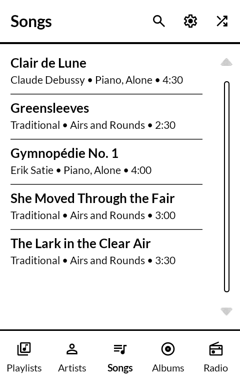
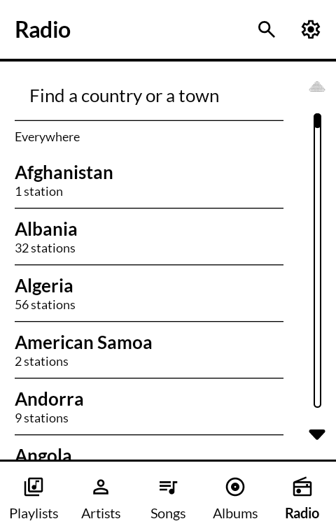
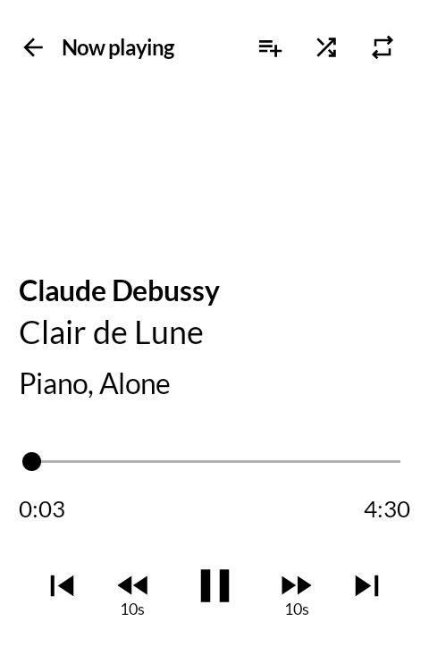
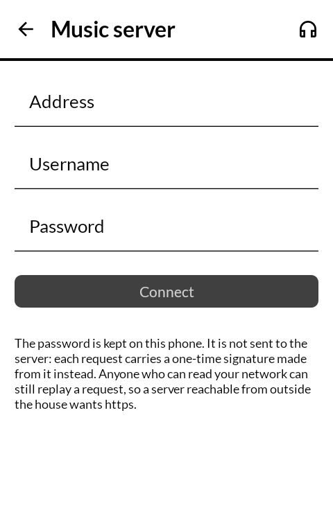

# 自鳴琴 jimeikin — Music Box

A music player for the [Mudita Kompakt](https://mudita.com/products/mudita-kompakt), for a
local library, for a Navidrome or other Subsonic server, and for YouTube Music search and
streaming.

*Jimeikin* is 自鳴琴 — a koto that sounds itself. It is what a music box was called before
オルゴール, the Dutch loanword, took the name over: 自 (self), 鳴 (to sound), 琴 (koto). It
names an instrument that plays with nobody sitting at it, which is what this is once it is on
the phone.

Fork of [CalmMusic](https://github.com/davidraywilson/CalmMusic) by
[David Ray Wilson](https://github.com/davidraywilson), adapted to the Kompakt's e-ink display
and Mudita's MMD design system. CalmMusic is no longer maintained upstream; its author moved
on to a different project.

| | |
|---|---|
|  |  |
|  |  |

## Local music

The cog, top right → **Add a folder**. The picker opens on the memory card if there is one,
and on the phone's own Music folder if not. Supported audio files are indexed into songs,
albums, artists and playlists, and play offline.

Artists are grouped by album artist where the files carry one, so an album credited to a
single artist stays a single artist however many guests appear on its tracks.

Any `.m3u` or `.m3u8` file inside a chosen folder becomes a playlist, in file order. Entries
naming files that are not on the phone are skipped. Editing the file on a computer and
scanning again rewrites that playlist rather than making a second one.

A song's tags can be changed from its long-press menu → **Edit details** (title, artist,
album, album artist, track number), and a whole album's name and album artist from the
pencil on its page. The change is written into the file itself. The tags go into a copy
first, the copy is read back to check them, and only then does it replace the original, so a
phone that dies partway leaves the old file or the new one, never half of either. Server
songs are the server's to change, and YouTube downloads cannot be tagged.

For any song, album or artist, local, streamed or from a server, hold it and choose **Edit
name**. The new name is kept in the app and shown everywhere in it; the file and the server
are left as they are. Leave the field empty to go back to the original. **File under** works
the same way for an artist whose songs are not files on the phone.

Hold a song and choose **Heart** to mark it; a small heart shows on its row, and a **Hearted**
list heads Playlists, to play, shuffle or download. Hearts stay on the phone.

A folder that cannot be read — a card that has not mounted yet, a folder that has gone away —
is reported as unread, and nothing under it leaves the library.

## A music server

Settings → **Music server**. Address, username, password, and it reads the whole library in
one go — artists, albums and songs appear beside the music on the card rather than in a room
of their own. Anything Subsonic answers works: Navidrome, Airsonic, Gonic.
A swipe down at the top of Artists, Albums, Songs or Playlists reads the server again, where there is one, and the music folders on the phone.

A song held both on the server and on the card is shown once, and it is the copy on the card
that survives, because that one plays with no network. The server goes on earning its place
for everything the card does not have. A dotted rule under a row means it needs the network.

Long press a song for **Download**, or use the download button on an album, an artist or a
playlist to download the lot. A downloaded song stops being a pointer to the server and
becomes a file: solid rule, plays offline, and a later sync leaves it alone. Formats the phone
cannot decode are asked for as mp3 instead of raw, so a Windows Media or Musepack track arrives
playable.

The server's playlists come across too, pointing at the copy on the phone wherever there is
one. A playlist already here under the same name is left alone — a server that keeps its
library on disk has usually imported the very `.m3u` files this app reads off the card.

**The password is kept on this phone**, because Subsonic signs each request with it rather
than sending it. That signature keeps the password off the wire; it does not stop anyone on
the wire replaying a request, so a server reachable from outside the house wants https.

## YouTube Music

Start typing in Search. No account is needed to search or to stream.

Artist pages list an artist's top songs, albums and singles. An album's page lists its tracks
in the album's own order, as YouTube Music's album page gives them. When you are looking at a
local album, missing tracks can be found and filled in from YouTube. Tracks can be downloaded
for offline playback, one at a time from a song's menu or Now Playing, or a whole album at once.

A song already downloaded is shown as its file wherever YouTube lists it again — an album, an
artist's songs — and is not offered for download a second time: the album's Download button
goes once every track on it is here, and pressing it fetches only the ones that are not. The app
remembers which video each download came from; one downloaded before it did is recognised by
its title and artist.

## Downloads

Songs from the music server and from YouTube go into one queue and download one at a time, in
the order asked for. While anything is downloading, a line along the bottom of every screen
says which song and how far along ("Downloading 4 of 12 · River Song · 40%"), and when the
queue empties it says how it went for a few seconds. Pressing it opens Downloads, which is also
the download icon at the top of the library and a row in Settings.

Downloads lists what is waiting, what is underway, and what finished in the last week (up to a
hundred), with the reason when one did not download. Each can be canceled while it waits or
downloads, and tried again if it failed, was canceled, or was cut off when the app was closed.
**Clear** forgets the finished ones.

Downloaded songs are ordinary music files in **Music/Music Box** — on the memory card if one is
in, and in the phone's own storage if not. They stay there if Music Box is removed, and file
managers and other music players can see them. Deleting a download in the app deletes its file.
A YouTube download is named by its title, a music-server one "Artist - Title". YouTube
downloads are AAC .m4a files, copied as YouTube sent them with nothing re-encoded, with their
title, artist and album in their tags, and the address of the video they came from in the
comment; covers are not put in the files. After a reinstall, choosing a folder in Settings that
holds Music/Music Box brings them back as downloads again: the address in each file's tags
tells the app which video it was, so YouTube's albums and search show it as on the phone, not
to be streamed or downloaded again. A file with no address in its tags comes back as one of
your own songs.
Downloads made before 2.18.0 are moved there once, the first time 2.18.0 opens: each file is
copied, checked, and only then is the old copy removed, with its playlists and hearts kept. On
Android 9 and 10 downloads stay in the app's own folder, as before, and go with the app.
YouTube downloads made before 2.18.2 could be Opus — WebM files under a .m4a name, or .m4a
files holding Opus — which some players, Apple's among them, will not play. From 2.18.2 each is
fetched again from YouTube as AAC, once, in the background: it waits behind anything you asked
for, for a network that is not metered (unless Settings > Fetch older downloads again over
mobile data is on), and while nothing is streaming, and shows in Downloads
as "From YouTube again, as AAC". The new file is tagged, checked to play and to be as long as
the old one, and only then swapped in, playlists and hearts kept, and the old file removed.
Only if YouTube has no AAC for a video is its Opus encoded as AAC on the phone instead, at
160 kb/s. One saved before a reinstall is replaced only once it is known again through a
chosen folder, as above; otherwise it is left as it is.

Downloads carry on with the screen off or the app in the background: a quiet notification says
"Downloading 4 of 12" and has a Stop button, and when the app is not on screen a last
notification says how the run ended. On Android 13 and later the app asks once, the first time
something is downloaded, whether it may show notifications; downloads work the same without.

Connecting a YouTube account under Settings → **YouTube account** makes search reflect it.
Nothing else in the app needs one.

Respect artists' rights and your local laws when streaming or downloading from YouTube.

## Radio

Two radios, which are not the same thing.

**Stations** are on the internet, browsed by place — country, then town, then what is on the
air there — or found with the magnifying glass, which on this screen looks for station names,
towns, and postcodes. A postcode is answered with the towns nearest it, which is what somebody
typing one is actually asking. Both lists take a filter as well, because France alone has more
than eighteen hundred stations.

Tap a station to hear it. Hold one to put it in **Favorite stations**, at the top of the Radio
tab under the two ways in; hold it again, there or anywhere else, to take it back out. Nothing
is written down until you hold a row, so a station can be listened to without joining a list. The list is [radio.garden](https://radio.garden)'s, which is worth browsing the way
that site is worth browsing: not by searching for a station you already know, but by going
somewhere. Keep one and it sits at the top of the screen. A kept station stores the address of
the stream itself, so it goes on playing whatever becomes of radio.garden.

**FM** is the phone's own tuner, if it has one, and the row opens it. The tuner shows the
frequency, holds the presets and scans; there is nothing to gain from a worse copy of it here.
Needs headphones — they are the aerial.

## The queue

One now-playing queue, mixing local files and YouTube tracks. Shuffle and repeat without
losing your place. The Now Playing screen is large type and little else.

## Opening a file from another app

Music Box is offered for any audio file — "Open with" in a file manager, a download, an
attachment. The file plays at once, on its own, through the same player and notification as
everything else, named by its own title tag or else by its file name. It is not added to the
library; the library is the folders chosen in Settings. Audiobooks (m4b) are left to Audio
Reading.

## On Glance's lock screen

With [Glance](https://github.com/wanderwildwood/hitome) installed, and Settings → **Show what is
playing in Glance** turned on, the song playing or paused shows on its lock-screen panel as
"Song — Artist", and nothing once playback stops. It is off to begin with, since the app's own
strip on the lock screen already shows the song.

Album covers stay inside the app. The song goes to the lock screen, the media notification and
a launcher's now-playing widget with no cover, so each draws its own plain look. A radio station
has no cover, so it goes out with this app's own icon, which says which app is playing.

## Installing

Android 9 (API 28) or newer. Download the APK from
[Releases](https://github.com/wanderwildwood/jimeikin/releases/latest) and open it; every
release is signed with the same key, so later ones install over it and keep your library,
playlists and settings. The newest release is always at
<https://github.com/wanderwildwood/jimeikin/releases/latest/download/jimeikin.apk>, with a
`.sha256` beside it.

For updates without doing this by hand, add this repository to
[Obtainium](https://github.com/ImranR98/Obtainium):

    https://github.com/wanderwildwood/jimeikin

## What it sends

Your settings and local library stay on the phone, and so do your downloads, in
Music/Music Box. The app goes online only for what you use: your own music server, at the
address you type in; radio.garden, to browse stations, and each station's own stream while it
plays; api.zippopotam.us, only for a US or Canadian postcode typed into the radio search; and
YouTube and YouTube Music, to search, stream and download audio, to ask what plays next when
Keep playing similar songs is on, and once to fetch again as AAC a song downloaded as Opus
before 2.18.2. There are no ads, no analytics and no tracking SDKs. The same is said in the
app, under **Privacy** and **Terms** in About (the **i** at the top right of Settings), which
also lists the open-source parts it is built with and links to this source.

A music server's password and a connected YouTube account's cookie are sealed with a key held
in the phone's keystore, which cannot be exported and is not itself backed up, and the file
holding them is excluded from Android's backups. Restoring this app onto a different phone
brings your playlists and settings and asks for the server login again, which is the intended
outcome rather than a shortcoming.

It asks for five permissions and uses all five: the network, a foreground service and its
notification for playback, and an exemption from battery optimisation so the system is less
likely to stop it. The library does not need storage access — folders are reached through the
system picker, which grants this app that folder and nothing else. Access to music files is
asked for only when another app hands over a file by its path rather than sharing it, which is
the one way a file opened from elsewhere cannot be read without it.

**That is all of them**, and one optional service besides. **Lock-screen controls** are an
accessibility service, off until you turn it on in Android's Accessibility settings (Settings →
Lock-screen controls goes there). The Kompakt's own lock-screen music widget is wired to
Mudita's player and shows nothing else, and only an accessibility service may draw above the
lock screen, so that is what this has to be. It draws Music Box's controls where Mudita's widget
sits, listens only to the system lock screen, and reads one thing there — whether the PIN field
is showing, so the controls can make way for it. It reads no other app, and it stands aside
when gezimos's Katapult launcher, whose lock-screen widget this follows, is drawing its own.
Installed from a file on Android 13 or later, Android may refuse that switch at first; the row
then says to open App info, tap ⋮, then **Allow restricted settings**, and try again.

It does not read other apps' notifications: that existed once to show controls for whatever
else was playing, which meant this app putting a panel over its own screen about somebody
else's audiobook. It is gone from the app, not merely unused.

## For developers

Android Studio, JDK 21, Android SDK Platform 37+, and a device or emulator on Android 9
(API 28) or newer. Clone, open in Android Studio, let Gradle sync, run the `app`
configuration.

```sh
./gradlew :app:assembleFullDebug     # or :app:assembleFullRelease
./gradlew :app:installFullDebug
```

There are two apps, from one source. **Music Box** (flavour `full`, application id
`com.wanderwildwood.jimeikin`) is this one, the GitHub release, tagged `v2.18.x`.
**Music Box K** (flavour `store`, `:app:assembleStoreRelease`, application id
`com.wanderwildwood.jimeikin.k`) is the one offered in Mudita's store: the same app without
YouTube Music. Its code (`app/src/full`), NewPipeExtractor and the words about it are not in that
APK at all; `app/src/store` stands in for them. It has its own name, its own version line
(1.0.0 onward, tagged `k-v1.0.0`), its own data and its own download folder (Music/Music Box K),
and installs beside Music Box; the two share only the signing key. Its description and privacy
policy are in [store-edition/](store-edition/). How a release of each is made is in
[RELEASING.md](RELEASING.md).

Both build types share a checked-in debug-style keystore; see `app/build.gradle.kts`. A
tagged push (`v*`) triggers a GitHub Actions release build that publishes a signed APK to
Releases.

## Credits

- Built on [CalmMusic](https://github.com/davidraywilson/CalmMusic) by David Ray Wilson (GPL-3.0).
- Station listings from [radio.garden](https://radio.garden), used as a directory only.
- YouTube stream resolution via [NewPipeExtractor](https://github.com/TeamNewPipe/NewPipeExtractor) by TeamNewPipe (GPL-3.0).
- UI built with Mudita's MMD component library for Kompakt (Apache 2.0), with the Lato typeface (SIL OFL 1.1) and Material Symbols icons (Apache 2.0).
- Tags read and written with [jaudiotagger](https://bitbucket.org/ijabz/jaudiotagger) (LGPL 2.1). NewPipeExtractor brings jsoup (MIT), nanojson (MIT or Apache 2.0) and Rhino (MPL 2.0). AndroidX, Jetpack Compose, Media3, Room, OkHttp, Kotlin and kotlinx.coroutines are Apache 2.0.
- The dialog that says why a song is not playing, and the `jimeikin://song` link, began as an idea and a first version by [heavencanthandle](https://github.com/heavencanthandle/Music-box).

## Privacy

Privacy: what the app stores and what it sends is set out in [PRIVACY.md](PRIVACY.md).

## Licence

GPL-3.0, the same as upstream CalmMusic. See [LICENSE](LICENSE).
